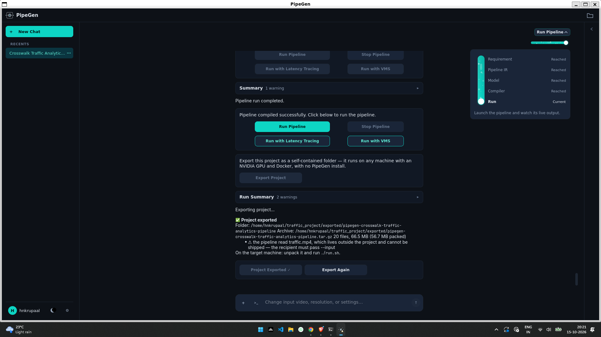
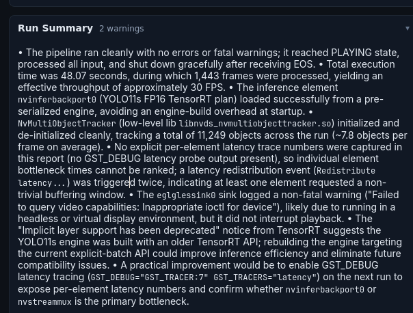
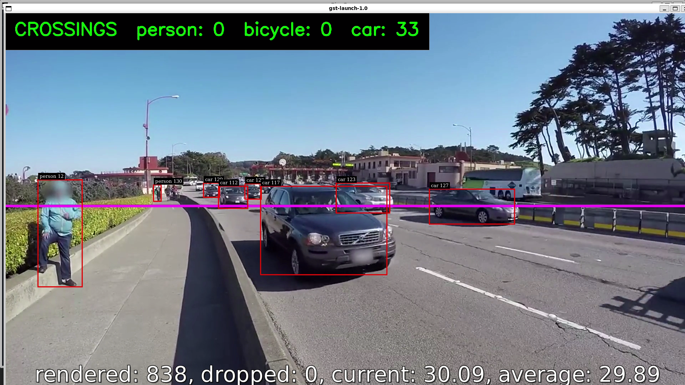
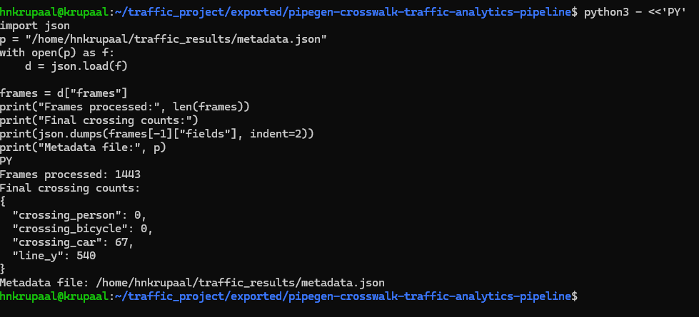
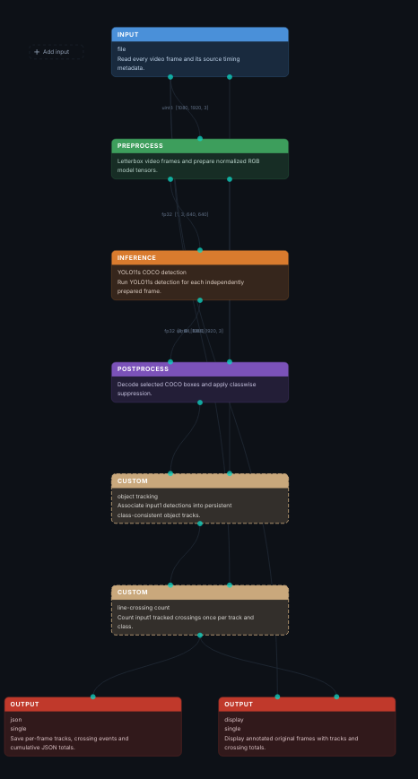

# Crosswalk Traffic Analytics Pipeline

A self-contained NVIDIA DeepStream pipeline, exported from PipeGen
0.5.1 on 2026-10-15T14:45:44Z.

## Requirements

- An NVIDIA GPU (a discrete GPU with driver 560.35.03 or newer, or a Jetson)
- Docker, with your user in the `docker` group
- The [NVIDIA Container Toolkit](https://docs.nvidia.com/datacenter/cloud-native/container-toolkit/)

You do **not** need PipeGen, Python, CUDA, TensorRT or DeepStream. They all
live inside a container image that `run.sh` fetches for you (~35 GB, once).

## Run it

```
./run.sh
```

That is the whole interface. The first run also builds the pipeline's parser
libraries and prepares the inference engine for your GPU, which takes about a
minute; every run after that starts straight into the pipeline.

## Options

| Flag | What it does |
| --- | --- |
| `--input <src>` | Read from a video file, an `rtsp://…` stream, or a camera such as `/dev/video0`. Defaults to whatever the pipeline was built against. |
| `--output <dir>` | Where results are written. Default: `./out` |
| `--headless` | Run with no window. Results still go to the output directory. |
| `--display` | Force a window. Fails if there is no display it can open. |
| `--rebuild` | Redo the first-run setup (parser build, engine preparation). |
| `--help` | The same list, from the script. |

Without `--headless` or `--display`, a window opens when a display actually
answers and the pipeline runs headless when none does — a `$DISPLAY` left over
from somewhere else is not enough, and `run.sh` says which it chose.

```
./run.sh --input clip.mp4 --output ~/results
./run.sh --input rtsp://192.168.1.50/live --headless
./run.sh --input /dev/video0
```

Run one at a time. A second run of the same folder would overwrite the first
one's results, so it is refused while the first is still going; copy the folder
if you want two at once.

## Tuning it

These are read from your environment and passed through to the pipeline. All
optional — leave them unset and the pipeline's own defaults apply.

| Variable | What it does |
| --- | --- |
| `CAM` `CAM_W` `CAM_H` `CAM_FPS` `CAM_FMT` | Camera device and capture mode. Use these when the automatic probe picks a mode your camera cannot deliver (`v4l2-ctl --list-formats-ext -d /dev/video0` lists the real ones). |
| `CAM_PROBE=0` | Do not probe the camera at all; use the values above as given. |
| `BITRATE` `FORCE_SW_ENC` | Recording bitrate in kbit/s; `FORCE_SW_ENC=1` uses the software H.264 encoder. |
| `JSON_OUT` `JSON_MIN_CONF` `JSON_MASK_OUTLINE` | Where the metadata JSON goes and what goes in it. |
| `MQTT_HOST` `MQTT_PORT` `MQTT_TOPIC` | Where to publish metadata, if this pipeline publishes. |
| `PG_GPU` | Which GPU to use on a multi-GPU machine — an index (`PG_GPU=1`) or a UUID. Default: all of them. |
| `PG_IMAGE` | Use a different container image tag. |

```
CAM_PROBE=0 CAM_W=640 CAM_H=480 ./run.sh --input /dev/video0
JSON_OUT=~/results/frames.json ./run.sh --input clip.mp4 --headless
```

## What is in this folder

| Path | |
| --- | --- |
| `run.sh` | The entry point. Checks this machine, starts the container, runs the pipeline. |
| `README.md` | This file. |
| `manifest.json` | What this was built from and on: GPU, TensorRT version, architecture, model checksums, precision. |
| `pipeline/pipeline.sh` | The pipeline itself. |
| `pipeline/first-run.sh` | The one-time setup, run inside the container. |
| `pipeline/configs/` (and `pipeline/labels/`, when the model has a label file) | Inference configuration. |
| `pipeline/parsers/` | C++ sources for the pipeline's custom libraries, built on your machine. |
| `models/` | The ONNX model and a prebuilt TensorRT engine. |
| `PipelineIR.json` | The pipeline's structure, for reference. |

The parser libraries ship as **source**, and the engine ships with a
fingerprint of the machine that produced it. That is what lets one exported
folder run on an x86 workstation and on a Jetson: `run.sh` compiles the
libraries for whatever it finds, and rebuilds the engine from the ONNX unless
your GPU and TensorRT version are an exact match for the ones recorded in
`manifest.json`.

## Moving it

The folder is relocatable. Copy it, rename it, hand it to someone else — there
are no absolute paths inside it. Everything is resolved relative to wherever
`run.sh` happens to be.

## Showing a window

Display mode has to let the container talk to your X server. `run.sh` copies a
single-display cookie into `.pipegen-state/xauth`, mounts it read-only, and
deletes it when the run ends — nothing about your display's access control is
changed. Only if `xauth` is unavailable does it fall back to `xhost
+local:root`, which relaxes that access control for every local program; in
that case it takes the grant back when the run finishes.

`.pipegen-state/` is created here on first use. It holds that cookie, the
first-run stamp and a lock file, and it is never part of what you were sent.

## If something goes wrong

`run.sh` checks the prerequisites first and names the fix for anything missing.
Two things it cannot check for you:

- **No camera.** If the pipeline was built against a camera you do not have,
  it says so and tells you to pass `--input`.
- **A different GPU.** That is expected — the engine is rebuilt from
  `models/*.onnx` automatically, which takes about a minute.
## Screenshots

### PipeGen Model Benchmark


### Pipeline Execution


### Annotated Traffic Video


### Crossing Metadata


### Pipeline IR Node Graph

